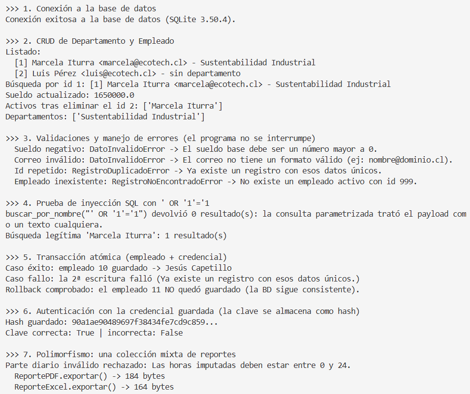

# EcoTech Solutions - Sistema de Gestión de Empleados (ES2 TI3021)

Aplicación de consola en Python basada en Programación Orientada a Objetos (POO) con persistencia en SQLite. Implementa el diagrama UML final de la Unidad 1.

## Integrantes y Roles
- **Amanda Hidalgo:** Liderazgo de proyecto, arquitectura de repositorio/base de datos e informe final.
- **Roberto Gajardo:** Diseño del diagrama UML final, clases de dominio y documentación técnica.
- **Jesús Capetillo:** Pruebas de ejecución, validación de flujos de consola y casos de prueba.

## Estructura del Proyecto
- `dominio/`: Clases del modelo (POO puro, sin SQL) y excepciones personalizadas.
- `repositorio/`: Conexión y acceso a la base de datos (consultas parametrizadas con SQLite).
- `datos/schema.sql`: Estructura de tablas con llaves primarias y foráneas.
- `docs/`: Diagrama UML final y documentación técnica.
- `main.py`: Menú interactivo por consola y modo demostración automática.

## Instrucciones de Ejecución

1. Abrir la terminal de VS Code en la carpeta raíz del proyecto.
2. Navegar a la subcarpeta que contiene el código fuente:
   ```bash
   cd ecotech_solutions

3. Ejecutar la demostración automática, que muestra la conexión, el CRUD, los errores controlados, la prueba de inyección SQL y la transacción con rollback:

```
python main.py --demo
```

Salida esperada:


 


4. Para usar el menú interactivo (registrar, buscar, actualizar y eliminar empleados):

```
python main.py
```

Si `python` no funciona en Windows, probar con `py main.py --demo`.
